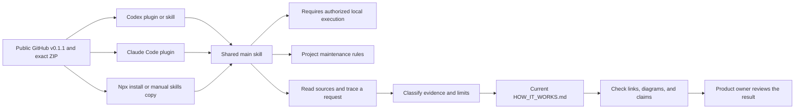
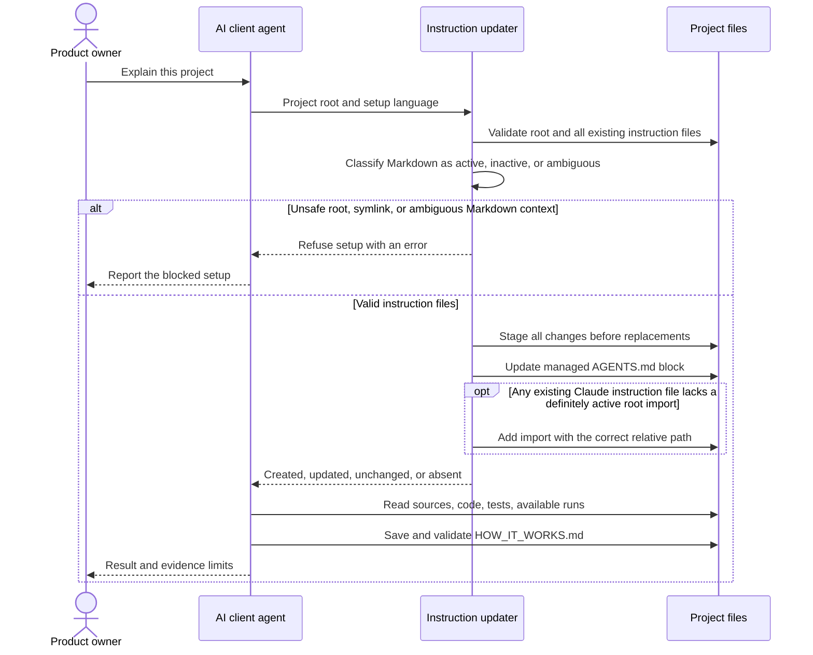
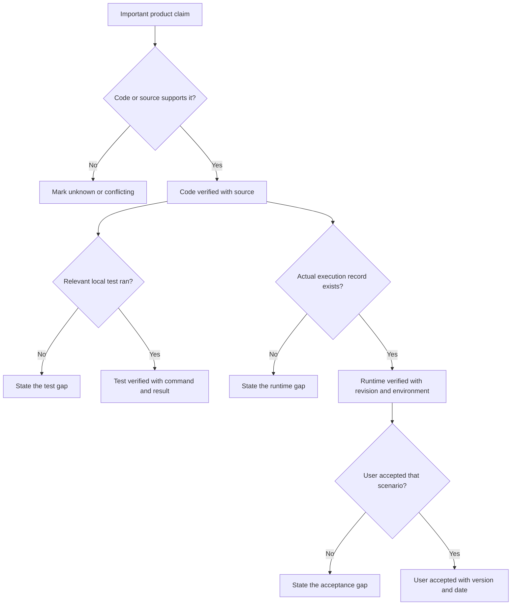

# How this skill works

How It Works gives a product owner one current explanation of a repository, with diagrams and evidence beside important claims.
It runs through an AI client that can read the project and execute authorized local checks.

## Current status and evidence

The shared workflow, project instruction updater, synthetic demo, and package checks exist.
The [v0.1.1 release](https://github.com/joevilcai666/how-it-works-skill/releases/tag/v0.1.1) and its exact ZIP are public.
Fresh isolated public installs passed for Codex, Claude Code, and npx on release commit `8bdbc8d`.
Both OpenAI manifest locations declare the bundled updater's local execution requirement.
Official directories remain `planned`, with no submission or acceptance.
The [distribution register](docs/distribution.md) records each channel and its remaining boundary.

| Evidence level | Current evidence | What this proves | Limit |
| --- | --- | --- | --- |
| code verified | [Main workflow](skills/how-it-works/SKILL.md), [updater](skills/how-it-works/scripts/update_project_instructions.py), [privacy scanner](scripts/privacy_scan.py), and [local execution metadata](plugin.json), public v0.1.1 at `8bdbc8d` | The package defines the workflow and implements local instruction setup and release checks | Instructions do not guarantee an agent follows every rule |
| test verified | 148 root tests, nine demo tests, both Agent Skills validators, Claude strict validation, and privacy checks passed for the v0.1.1 package | Local cases check execution metadata, version parity, refusal before writes, both Claude instruction locations, Markdown classification, historical filenames, tag-only blobs, SVG resources, and isolated skill assets | Local checks and source diagrams do not prove an OpenAI desktop install or visual render |
| runtime verified | [v0.1.1 public installs](docs/verification/v0.1.1.md), 2026-10-15. [Earlier model trial](docs/verification/v0.1.0.md), 2026-10-14, code `dd734d0` | Codex and Claude enabled version 0.1.1. Installed skill files and manifests matched the release. Npx copied the tag's main skill. Earlier Codex saved a synthetic document | No new v0.1.1 model run. Earlier Codex met 6 of 7 rubric checks. Earlier Claude HTTP 401 blocked a document and import-use trial |
| user accepted | No acceptance record | Nothing yet | A product owner must review a real project explanation before this level applies |

Code is a recipe. A local test checks a prepared example.
A runtime record shows one actual execution. User acceptance shows that the result meets the user's need.
One level does not automatically prove the next level.

## From install to product explanation

The client loads one shared skill, regardless of the install route.
The main skill first runs project instruction setup, then directs repository investigation and document work.
The package needs a client with authorized local execution.



The portable manifest, Codex overlay, and Claude marketplace describe the same package.
They do not hold separate copies of the investigation workflow.
The setup adapter only installs maintenance rules and hands document requests to the main skill.
Python 3.9 or later is required for the updater. No hosted analysis service exists.
The [OpenAI desktop-only guide](https://developers.openai.com/plugins/deploy/desktop-only) covers skills that call local programs, including this Python updater.
Root `plugin.json` declares `requires_local_executor: true` under `extensions.com.openai`.
The legacy `.codex-plugin/plugin.json` declares the same field at its top level.
This flag is like a label on a power plug: it states the required execution environment.
It does not grant file access or prove that a client installed the package.
The package includes no MCP server or extra permissions.
The main skill includes its own icons. A standalone skill copy does not need the repository's root assets.

## What happens on the first request

The agent resolves the project root and the installed skill directory.
Setup adds or replaces one marker-bounded block in root `AGENTS.md`.
Markers work like labeled bookends: they show which text the updater owns.
Unrelated project instructions remain outside those bookends.



Repeated setup does not duplicate the managed block.
The updater checks root `CLAUDE.md` and `.claude/CLAUDE.md` when they exist.
Root instructions use `@AGENTS.md`. Nested instructions use `@../AGENTS.md`.
If both files exist, setup checks and updates both. It reports `absent` only when neither exists.
It preserves unrelated text and recognizes equivalent imports in supported prose and lists, outside code and comments.
Setup classifies context as definitely active instructions, definitely inactive examples, or ambiguous markup.
Standalone imports, inline prose, simple lists, and explicit quote/list paragraph continuations have support.
Actual indented code remains inactive. Extra spaces in a supported paragraph continuation do not make its import inactive.

Ambiguous or unsupported context stops setup before any file change.
Lazy quote continuations, nested quote containers, and raw HTML blocks fall outside this parser's supported subset.
A lazy quote continuation omits a quote marker on a later line. It is like a quotation with unclear closing punctuation.
Simplify that markup before another setup run. A refusal does not report successful installation.

Fences keep the containers and indentation of their opening line.
Their contents cannot change list or paragraph state. A closing token permits at most three extra spaces inside those containers.
Setup recognizes complete single-line link definitions with supported destinations and optional simple quoted or parenthesized titles.
Valid definitions do not open paragraphs. Indented code after a definition cannot supply an active import.
Ordinary prose such as `[Note]: Use @AGENTS.md for rules.` retains its import.
Incomplete or uncertain reference-like syntax causes refusal before writes.

Closed comments are inactive examples, even when they contain HTML, nested quotes, or apparent fences.
Comment bodies cannot change paragraph or container state.
The supported multiline form closes on its own line. Additional text on that closing line causes refusal.
Unclosed comments also cause refusal. Actual HTML outside comments remains unsupported.

Managed markers must occupy separate lines at column one, outside code, comments, and list or quote examples.
Setup refuses inactive, incomplete, duplicated, or overlapping markers before any write.
It also refuses unclosed fences or comments, symlink targets, and a symlink `.claude` directory.
The updater does not create either Claude instruction file or edit user-global instructions.
It validates every target and stages all changes before the first replacement.
File replacements use temporary files. An operating-system failure between replacements can still leave a partial result.

## Investigation and later updates

The agent reads applicable instructions and establishes the project's source order.
Product intent describes the desired result. Code and execution evidence describe the current result.
The agent keeps conflicts visible when no source order resolves them.

The agent traces one important request through input, decisions, state, effects, and visible output.
It checks relevant permissions, retries, duplicates, cancellation, restart, and failure paths.
It marks absent or unknown capabilities. It does not invent them.

On later requests, the agent compares the document with current code and evidence.
It updates affected sections and removes false claims.
It keeps one current-state document in the user's language, without a change history.
The maintenance block asks future agents to update this document after product changes.
It does not run a watcher or force every agent to obey the contract.

## How evidence controls the claim

Every important claim needs a source and a stated limit.
A diagram is a map of inspected behavior, not evidence that the behavior ran.



Synthetic runtime data demonstrates the format. It cannot prove actual execution.
A local agent session proves only that session and its saved output.
A build, manifest validator, or directory entry cannot prove the result meets a product owner's need.

## Module responsibilities

| Module | Responsibility | Product effect |
| --- | --- | --- |
| [Main skill](skills/how-it-works/SKILL.md) | Direct source inspection, evidence classification, document updates, and completion checks | Gives the owner a consistent explanation process |
| [Setup adapter](skills/how-it-works-setup/SKILL.md) | Run the shared updater and refer document work to the main skill | Prepares project maintenance without a second workflow |
| [Updater](skills/how-it-works/scripts/update_project_instructions.py) and [language assets](skills/how-it-works/assets/maintenance-block.en.md) | Preserve unrelated instructions and manage owned blocks | Makes repeated setup predictable |
| [References](skills/how-it-works/references/output-contract.md) | Define source order, evidence, useful diagrams, and symptom-first diagnosis | Keeps claims understandable and limited by evidence |
| [Plugin identity](plugin.json) and client overlays | Expose shared skills to supported package readers | Enables multiple install routes without duplicate skill text |
| [Acorn Tasks demo](demo/acorn-tasks/README.md) | Provide synthetic code, tests, and fictional run data | Shows the output without private project information |
| [Evaluation rubric](evals/run_rubric.py) | Check observable document properties | Detects omissions but cannot judge all claim truth |
| [Repository checker](scripts/check_repo.py) and [privacy scanner](scripts/privacy_scan.py) | Check package structure, tests, links, fences, assets, and known disclosures | Blocks known local defects before release |
| [Distribution register](docs/distribution.md) | Record channel status, release identity, permissions, update and removal routes | Prevents package files from becoming unsupported publication claims |

## Output and validation

The output explains current behavior, a representative request, module responsibilities, concepts, decisions, symptoms, and evidence gaps.
It uses two to four useful Mermaid diagrams and local source links.
The document records its review date and analyzed revision when available.

Run these local checks from this repository:

```bash
python3 -m unittest discover -s tests -v
python3 -m unittest discover -s demo/acorn-tasks/tests -v
python3 scripts/check_repo.py
```

The repository checker, both Agent Skills validators, and Claude strict validation passed for public v0.1.1 at `8bdbc8d`.
Nine synthetic demo tests also passed. The package verification date is 2026-10-15.
New tests cover both local execution declarations and version parity. The checker rejects missing, false, and non-boolean declarations.
It runs the root tests, manifest consistency checks, local Markdown links, Mermaid counts, fences, privacy scans, and Git whitespace checks.
It also runs `skills-ref` and Claude strict validation when installed.
It prints a skip when a validator is absent. A skip is not a validation pass.

The privacy scanner checks current filenames and file contents, including tracked files that ignore rules otherwise exclude.
The history check inspects every reachable commit tree. It checks deleted and renamed filenames, including multiple names for one blob.
Git separates these names with NUL bytes, so spaces, tabs, and line breaks cannot divide a filename.
Named findings report a redacted path, rule, line, and a commit that contains the entry.
The scanner also checks blobs reachable only through tags. It uses the blob object identifier when no containing commit exists.

SVG checks cover resource references, inherited XML bases, CSS URL functions, CSS string imports, and XML stylesheet instructions.
They also check resource attributes inside `foreignObject`, including namespaced attributes and resource lists.
The scanner resolves references without network or file access. It also checks SVG metadata, embedded images, and PNG metadata.

Its Mermaid check covers source presence, block counts, and fences. It does not render or parse every diagram.
The agent must render diagrams when a renderer is available and report which check occurred.

## Where to investigate

| Symptom | Inspect first | Next useful check |
| --- | --- | --- |
| Setup refuses the project | Root, symlinks, and marker ownership | Run the updater with `--dry-run` on the intended root |
| Document claims a service works without a real run | Claim source and evidence label | Request a redacted execution record for that revision |
| Document becomes stale | Managed instruction block and affected product flow | Invoke the main skill to refresh current-state content |
| A client cannot find the skill | Complete installed directory and client package reader | Record client version, install command, and discovery result |
| A local check passes but the explanation is wrong | Source authority and human review | Trace the request again and correct the claim |

## Limitations and distribution

The package supplies agent instructions and a local updater. The client supplies repository access, model execution, tools, and permission controls.
The public package has isolated CLI installation evidence.
A clean OpenAI desktop installation, a new model run, and portal acceptance remain unverified.
The skill adds no telemetry or upload service. The client and third-party installers retain their own data policies.
Privacy checks detect known patterns and image metadata. They cannot guarantee the absence of every sensitive fact.

No cross-client document acceptance exists yet.
The earlier Codex CLI 0.162.1 trial loaded both skills and completed one synthetic document on candidate `dd734d0`.
It passed six rubric checks. Its two diagrams failed the original case's three-diagram threshold.
The request did not specify three diagrams, and the skill permits two to four.
The document links resolved, but no Mermaid renderer was available.

The earlier Claude Code 2.1.295 trial discovered both skills through the local plugin path.
Its configured provider returned HTTP 401, so document execution and use of imported project instructions remain unverified.
Updater checks preserved `AGENTS.md`, root `CLAUDE.md`, and `.claude/CLAUDE.md`, with one correct relative import in each Claude file.
Repeat runs left all three files unchanged. Ambiguous nested markup returned exit 2 before any file change.
Fresh setup created `AGENTS.md` and left both Claude instruction locations absent.
The [earlier v0.1.0 record](docs/verification/v0.1.0.md) retains these model and updater trials.
Those trials do not prove a new v0.1.1 model run.

The current [v0.1.1 record](docs/verification/v0.1.1.md) verifies a fresh public tag clone and three isolated install routes.
Codex CLI 0.162.1 and Claude Code 2.1.218 enabled plugin version 0.1.1.
Both installed skill directories and both local execution declarations matched the public package.
The generic installer 1.7.2 copied the tag's main skill with identical files.
No client executed a new model request. Installation does not prove document acceptance.

The public GitHub release and three public install routes have verification records.
The annotated `v0.1.1` tag identifies `8bdbc8d`. Its exact ZIP hash appears in the [distribution register](docs/distribution.md).
The uploaded asset's digest and an independently hashed download matched.
Both released tags remain fixed. The temporary install workspace moved to Trash, with recovery possible.
Official directory submissions remain pending because authenticated portal access did not complete.
The skills.sh [skill page](https://skills.sh/joevilcai666/how-it-works-skill/how-it-works) is discoverable as of 2026-10-15.
It does not expose v0.1.1 identity or the release checksum. Page visibility does not prove completed audits, install count, ranking, or document acceptance.
AgentSkill.sh import remains pending account and terms review. No optional webhook exists.
SkillsMP lacks verified release identity and an explicit listing-removal process, so proactive submission is rejected.
The social preview image is public as a file. Its upload to the GitHub setting remains unverified.
The computer UI reported a lock, and browser actions failed or timed out.
Directory submission, directory acceptance, and product-owner acceptance remain separate evidence levels.

Sources: [workflow](skills/how-it-works/SKILL.md), [updater tests](tests/test_update_project_instructions.py), [evaluation record](evals/README.md), [package checker](scripts/check_repo.py).

Product-owner summary: v0.1.1 is public, with a verified ZIP and three fresh public install routes.
Official directories, the social preview setting, and a clean OpenAI desktop installation remain unverified.
New model execution, Mermaid visual rendering, and product-owner acceptance still need separate evidence.

Analyzed public package: `8bdbc8d06f1c9e572482dc6034a2d63fd2a42739`, tag `v0.1.1`.
Local model trial code: `dd734d08e1a185a719a37a88038338609cd4140d`.

Last reviewed: 2026-10-15
