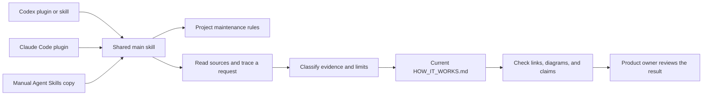
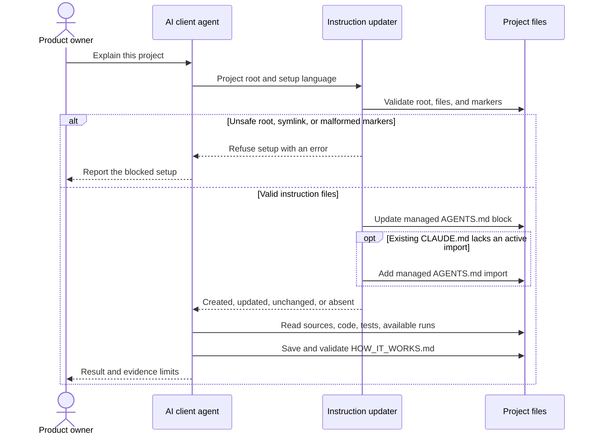
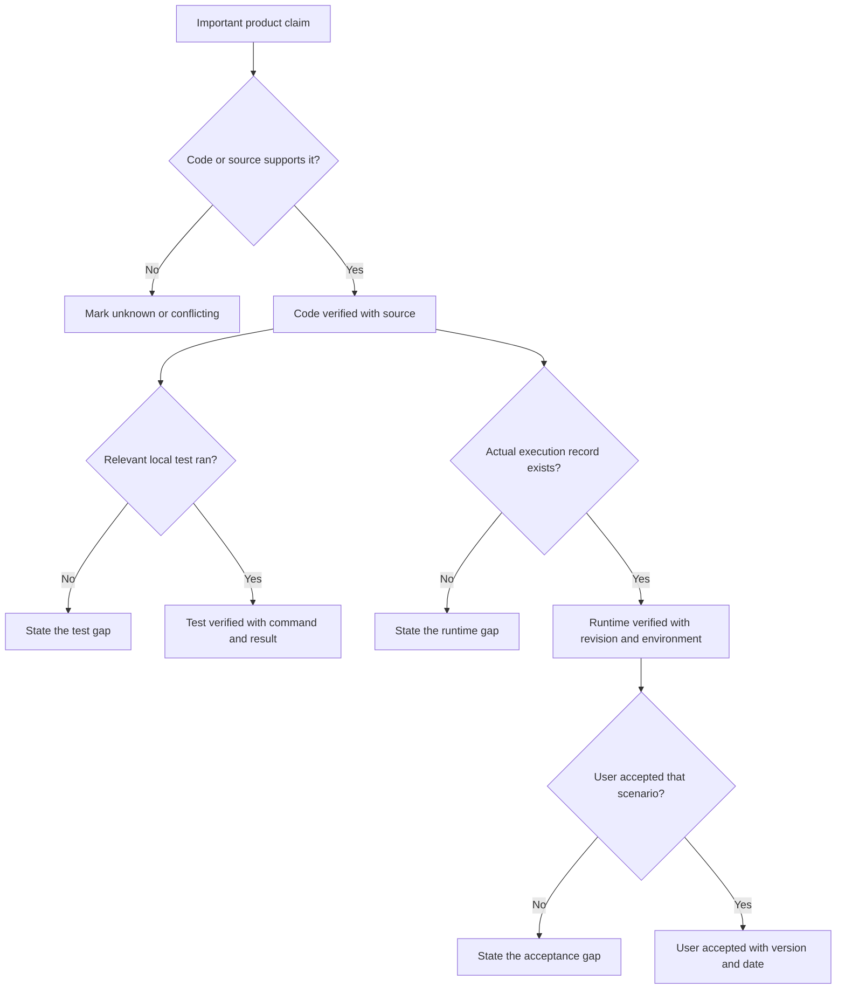

# How this skill works

How It Works gives a product owner one current explanation of a repository, with diagrams and evidence beside important claims.
It runs through an AI client that can read the project and execute authorized local checks.

## Current status and evidence

The shared workflow, project instruction updater, synthetic demo, and package checks exist.
Public distribution remains `planned`. No official directory acceptance or public install record exists in this release preparation.

| Evidence level | Current evidence | What this proves | Limit |
| --- | --- | --- | --- |
| code verified | [Main workflow](skills/how-it-works/SKILL.md), [updater](skills/how-it-works/scripts/update_project_instructions.py), core revision `a56c61f` | The package defines the workflow and implements local instruction setup | Instructions do not guarantee an agent follows every rule |
| test verified | 107 root tests and 9 synthetic demo tests passed locally on 2026-10-14, Python 3.9.6, macOS arm64. See [updater tests](tests/test_update_project_instructions.py), [package tests](tests/test_check_repo.py), and [public-document tests](tests/test_public_docs.py) | Local cases check state, refusal behavior, package structure, and public assets | These results cover local scenarios. Final release checks must use the exact release commit |
| runtime verified | [Synthetic agent comparison](evals/README.md), one Codex collaboration client on 2026-10-14 | The enabled agent created a saved document and met 6 of 7 rubric checks | Two diagrams failed the case's three-diagram threshold. Public client installation remains unverified |
| user accepted | No acceptance record | Nothing yet | A product owner must review a real project explanation before this level applies |

Code is a recipe. A local test checks a prepared example.
A runtime record shows one actual execution. User acceptance shows that the result meets the user's need.
One level does not automatically prove the next level.

## From install to product explanation

The client loads one shared skill, regardless of the install route.
The main skill first runs project instruction setup, then directs repository investigation and document work.



The portable manifest, Codex overlay, and Claude marketplace describe the same package.
They do not hold separate copies of the investigation workflow.
The setup adapter only installs maintenance rules and hands document requests to the main skill.
Python 3.9 or later is required for the updater. No hosted analysis service exists.

## What happens on the first request

The agent resolves the project root and the installed skill directory.
Setup adds or replaces one marker-bounded block in root `AGENTS.md`.
Markers work like labeled bookends: they show which text the updater owns.
Unrelated project instructions remain outside those bookends.



Repeated setup does not duplicate the managed block.
The updater does not create `CLAUDE.md` or edit user-global instructions.
It checks both instruction targets before writes and refuses ambiguous marker ownership.
File replacements use temporary files. This is not a transaction across both files if the operating system fails between replacements.

## Investigation and later updates

The agent reads applicable instructions and establishes the project's source order.
Product intent describes the desired result. Code and execution evidence describe the current result.
The agent keeps conflicts visible when no source order resolves them.

The agent traces one important request through input, decisions, state, effects, and visible output.
It checks relevant permissions, retries, duplicates, cancellation, restart, and failure paths.
It marks absent or unknown capabilities. It does not invent them.

On later requests, the agent compares the document with current code and evidence.
It updates affected sections and removes false claims.
It keeps one current-state document in the user's language, without a change history.
The maintenance block asks future agents to update this document after product changes.
It does not run a watcher or force every agent to obey the contract.

## How evidence controls the claim

Every important claim needs a source and a stated limit.
A diagram is a map of inspected behavior, not evidence that the behavior ran.



Synthetic runtime data demonstrates the format. It cannot prove actual execution.
A local agent session proves only that session and its saved output.
A build, manifest validator, or directory entry cannot prove the result meets a product owner's need.

## Module responsibilities

| Module | Responsibility | Product effect |
| --- | --- | --- |
| [Main skill](skills/how-it-works/SKILL.md) | Direct source inspection, evidence classification, document updates, and completion checks | Gives the owner a consistent explanation process |
| [Setup adapter](skills/how-it-works-setup/SKILL.md) | Run the shared updater and refer document work to the main skill | Prepares project maintenance without a second workflow |
| [Updater](skills/how-it-works/scripts/update_project_instructions.py) and [language assets](skills/how-it-works/assets/maintenance-block.en.md) | Preserve unrelated instructions and manage owned blocks | Makes repeated setup predictable |
| [References](skills/how-it-works/references/output-contract.md) | Define source order, evidence, useful diagrams, and symptom-first diagnosis | Keeps claims understandable and limited by evidence |
| [Plugin identity](plugin.json) and client overlays | Expose shared skills to supported package readers | Enables multiple install routes without duplicate skill text |
| [Acorn Tasks demo](demo/acorn-tasks/README.md) | Provide synthetic code, tests, and fictional run data | Shows the output without private project information |
| [Evaluation rubric](evals/run_rubric.py) | Check observable document properties | Detects omissions but cannot judge all claim truth |
| [Repository checker](scripts/check_repo.py) and [privacy scanner](scripts/privacy_scan.py) | Check package structure, tests, links, fences, assets, and known disclosures | Blocks known local defects before release |
| [Distribution register](docs/distribution.md) | Record channel status, release identity, permissions, update and removal routes | Prevents package files from becoming unsupported publication claims |

## Output and validation

The output explains current behavior, a representative request, module responsibilities, concepts, decisions, symptoms, and evidence gaps.
It uses two to four useful Mermaid diagrams and local source links.
The document records its review date and analyzed revision when available.

Run these local checks from this repository:

```bash
python3 -m unittest discover -s tests -v
python3 -m unittest discover -s demo/acorn-tasks/tests -v
python3 scripts/check_repo.py
```

The repository checker passed locally on 2026-10-14. Both Agent Skills validators and Claude strict validation also passed.
It runs the root tests, manifest consistency checks, local Markdown links, Mermaid counts, fences, privacy scans, and Git whitespace checks.
It also runs `skills-ref` and Claude strict validation when installed.
It prints a skip when a validator is absent. A skip is not a validation pass.

Its Mermaid check covers source presence, block counts, and fences. It does not render or parse every diagram.
The agent must render diagrams when a renderer is available and report which check occurred.

## Where to investigate

| Symptom | Inspect first | Next useful check |
| --- | --- | --- |
| Setup refuses the project | Root, symlinks, and marker ownership | Run the updater with `--dry-run` on the intended root |
| Document claims a service works without a real run | Claim source and evidence label | Request a redacted execution record for that revision |
| Document becomes stale | Managed instruction block and affected product flow | Invoke the main skill to refresh current-state content |
| A client cannot find the skill | Complete installed directory and client package reader | Record client version, install command, and discovery result |
| A local check passes but the explanation is wrong | Source authority and human review | Trace the request again and correct the claim |

## Limitations and distribution

The package supplies agent instructions and a local updater. The client supplies repository access, model execution, tools, and permission controls.
The skill adds no telemetry or upload service. The client and third-party installers retain their own data policies.
Privacy checks detect known patterns and image metadata. They cannot guarantee the absence of every sensitive fact.

No cross-client runtime acceptance exists yet.
The recorded synthetic enabled-agent result falls short of one evaluation case, as described above.
Generic client support follows the package specification, but each client still needs an actual install and document run.

All five channels in the [distribution register](docs/distribution.md) remain `planned` until public verification.
Release `v0.1.0`, archive checksum, directory entry URLs, and policy review evidence remain `pending`.
Directory submission is not runtime-verified. No file or local test proves published-directory acceptance.

Sources: [workflow](skills/how-it-works/SKILL.md), [updater tests](tests/test_update_project_instructions.py), [evaluation record](evals/README.md), [package checker](scripts/check_repo.py).

Analyzed core revision: `a56c61f`. Public documentation and assets belong to the current release preparation.

Last reviewed: 2026-10-14
