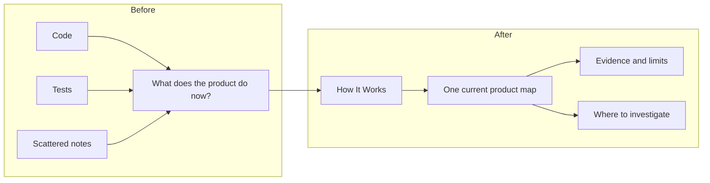

# How It Works

[简体中文](README.zh-CN.md)

Your codebase works. Your product explanation goes stale.

This skill turns the current repository into a living, visual product explanation.
Give a product owner one place to see what the product does, how a request travels, and what the evidence proves.



| Understand current behavior | Separate proof from assumption | Know where to investigate |
| --- | --- | --- |
| Follow a user request from input to result. | Distinguish code, local tests, real runtime, and user acceptance. | Use symptoms to find the responsible module and next check. |

## Five-minute first use

Use an Agent Skills client with repository access and Python 3.9 or later.
The `npx` route also requires Node.js and npm.
Without `npx`, use [manual installation](#manual-install).
Install the main skill:

```bash
npx skills add joevilcai666/how-it-works-skill --skill how-it-works
```

Open your project in the client. Send this prompt:

```text
$how-it-works
Create HOW_IT_WORKS.md for a non-technical product owner in English.
Trace one important user request. Use 2–4 useful Mermaid diagrams.
Separate code, local tests, real runtime, and user acceptance evidence.
Mark missing evidence. Use synthetic examples and omit private records.
```

The first run adds project-local maintenance rules to `AGENTS.md`.
It preserves unrelated instructions and adds an `@AGENTS.md` import to a project's `CLAUDE.md` when needed.
It does not create `CLAUDE.md` or change global instructions.
The agent then creates or refreshes one `HOW_IT_WORKS.md` in your language.
Large repositories can take more than five minutes to inspect.

See the [synthetic Acorn Tasks project](demo/acorn-tasks/README.md) and its [example product explanation](demo/expected/HOW_IT_WORKS.md).
All demo data is fictional. The example does not prove production operation.

Release status: `0.1.0` is a local release candidate.
Public installation and official directory acceptance remain unverified.
The commands below describe the planned public routes. See the [distribution register](docs/distribution.md).

## Install options

### Codex: skill or portable plugin

Use the `npx skills` command above for the main skill.
For the portable plugin, add this repository as a marketplace and install its plugin:

```bash
codex plugin marketplace add joevilcai666/how-it-works-skill
codex plugin add how-it-works@how-it-works-skill
```

For a local checkout, add its directory instead:

```bash
git clone https://github.com/joevilcai666/how-it-works-skill.git
codex plugin marketplace add ./how-it-works-skill
codex plugin add how-it-works@how-it-works-skill
```

Keep the full checkout for this route. The root `plugin.json` describes the portable package.
The Codex overlay and repository marketplace point to the same `skills/` directory.
The plugin also includes a small setup skill.
Codex CLI help confirms these command forms. End-to-end installation still needs release verification.

### Claude Code: repository marketplace

Run these commands in Claude Code:

```text
/plugin marketplace add joevilcai666/how-it-works-skill
/plugin install how-it-works@how-it-works-skill
```

Use the loaded skill through the client's skill menu or supported invocation syntax.
The package includes a Claude manifest and a repository marketplace.
Local strict manifest validation does not prove a successful client session.

<a id="manual-install"></a>

### Generic Agent Skills clients: manual copy

Download the repository or clone it. Copy the complete main skill directory:

```bash
git clone https://github.com/joevilcai666/how-it-works-skill.git
cp -R how-it-works-skill/skills/how-it-works <client-skill-directory>/how-it-works
```

Replace `<client-skill-directory>` with your client's documented skill directory.
Keep `SKILL.md`, `references/`, `assets/`, and `scripts/` together.
Invoke `how-it-works` through your client's supported syntax.
Generic clients do not need the plugin manifests or setup adapter.

## Compatibility and evidence

| Client or component | Available package support | Verified here | Still unverified |
| --- | --- | --- | --- |
| Codex | Agent Skills, portable `plugin.json`, Codex overlay, setup skill | Package checks and one synthetic agent session | Public install, plugin loading, full acceptance |
| Claude Code | Shared skills, plugin manifest, repository marketplace | Local strict manifest validation | Installation and real client document run |
| Generic Agent Skills client | Complete `skills/how-it-works/` directory | Local Agent Skills validator | Each client's skill discovery and execution |
| Instruction updater | Python 3.9+, English and Chinese maintenance blocks | Idempotency, preservation, refusal cases, local unit tests | Every filesystem and instruction configuration |

The [recorded synthetic agent run](evals/README.md) met 6 of 7 rubric checks.
It used two diagrams. The case requires three, while the skill permits two to four.
This result does not prove cross-client compatibility or user acceptance.

Document language follows the request. Setup blocks support English and Simplified Chinese.
Other languages use the English setup block while the document keeps the requested language.

## What the skill changes

The agent reads project instructions, product sources, code, tests, and available runtime evidence.
It traces a representative request and writes current behavior, diagrams, module responsibilities, concepts, diagnosis guidance, and limitations.
Later runs update the affected content and remove false statements.
The maintenance block asks future agents to keep the document current after product changes.
It is an instruction contract, not a background watcher or an automatic enforcement hook.

See [how this package works](HOW_IT_WORKS.md), the [main workflow](skills/how-it-works/SKILL.md), and the [evidence rules](skills/how-it-works/references/evidence.md).

## Privacy

The skill adds no telemetry and no repository upload service.
Its updater operates on local project instruction files.
Your AI client still controls model access, permissions, and its own data policy.
Third-party installers can have their own telemetry. Review their policy or use the manual copy route.

Keep secrets, private messages, and sensitive records out of generated examples and public reports.
Use synthetic fixtures and redacted evidence. A privacy scan cannot prove that every possible disclosure is absent.
Report vulnerabilities through [private reporting](SECURITY.md).

## Contribute

Send a synthetic bug example, a client compatibility report, or a clear improvement request.
Read [CONTRIBUTING.md](CONTRIBUTING.md) for local checks and evidence requirements.
The package uses the [MIT license](LICENSE).
See the [0.1.0 release draft](docs/releases/v0.1.0.md) and [changelog](CHANGELOG.md).
