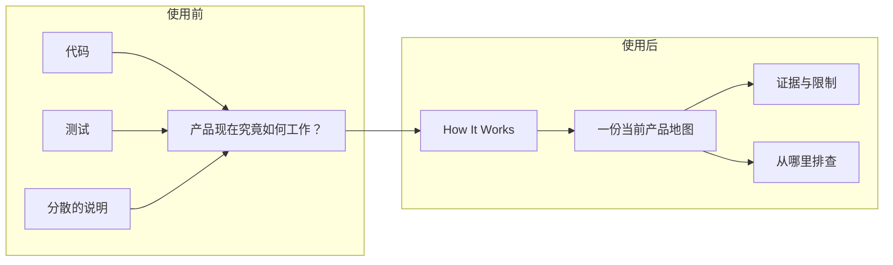

# How It Works

[English](README.md)

代码在运行，产品说明却逐渐过时。

这个技能把当前仓库变成一份持续更新的可视化产品说明。
产品负责人可以在一个地方看清：产品现在做什么，请求如何执行，证据能证明什么。



| 理解当前行为 | 区分证据与假设 | 知道从哪里排查 |
| --- | --- | --- |
| 跟随一次用户请求，从输入看到结果。 | 分清代码、本地测试、真实运行和用户验收。 | 根据症状找到负责模块和下一步检查。 |

## 五分钟开始使用

准备支持 Agent Skills 的客户端、仓库访问权限，以及 Python 3.9 或更高版本。
`npx` 安装方式还需要 Node.js 和 npm。
如果没有 `npx`，请使用[手动安装](#manual-install)。
安装主技能：

```bash
npx skills add joevilcai666/how-it-works-skill --skill how-it-works
```

在客户端打开你的项目，然后发送：

```text
$how-it-works
为非技术产品负责人创建中文 HOW_IT_WORKS.md。
追踪一次重要用户请求。使用 2–4 个有用的 Mermaid 图。
区分代码、本地测试、真实运行和用户验收证据。
明确缺失的证据。只使用合成示例，不写入私人记录。
```

首次执行会把项目维护规则加入 `AGENTS.md`，并保留其他指令。
如果项目已有 Claude 项目指令，程序会在需要时加入根目录 `AGENTS.md` 的引用。
根目录 `CLAUDE.md` 使用 `@AGENTS.md`。`.claude/CLAUDE.md` 使用 `@../AGENTS.md`。
如果两个文件都存在，程序会检查并更新两者。程序不会创建这两个文件，也不会修改全局指令。
如果 Markdown 上下文不明确或程序不支持该结构，程序会在修改任何指令文件前停止。简化格式后再执行。
随后，Agent 按你的语言创建或更新项目根目录的 `HOW_IT_WORKS.md`。
大型仓库的分析可能超过五分钟。

查看[合成 Acorn Tasks 项目](demo/acorn-tasks/README.md)和它的[产品说明示例](demo/expected/HOW_IT_WORKS.md)。
所有示例数据都是虚构数据。示例不能证明生产系统已经运行成功。

发布状态：[v0.1.1](https://github.com/joevilcai666/how-it-works-skill/releases/tag/v0.1.1) 已公开发布。
[v0.1.1 验证记录](docs/verification/v0.1.1.md)确认 Codex、Claude Code 和 `npx skills` 的公开安装通过隔离验证。
该记录提供准确的 ZIP 与校验和。
官方目录尚未提交或收录。详见[分发登记表](docs/distribution.md)。
[skills.sh 页面](https://skills.sh/joevilcai666/how-it-works-skill/how-it-works)于 2026-10-15 确认可发现。
页面未显示 v0.1.1 版本或 ZIP 校验和。页面可见不能证明审查完成、安装量或排名。

## 安装方式

### Codex：技能或可移植插件

使用上面的 `npx skills` 命令安装主技能。
安装可移植插件时，先添加仓库市场，再安装插件：

```bash
codex plugin marketplace add joevilcai666/how-it-works-skill
codex plugin add how-it-works@how-it-works-skill
```

也可以通过本地仓库目录添加市场：

```bash
git clone https://github.com/joevilcai666/how-it-works-skill.git
codex plugin marketplace add ./how-it-works-skill
codex plugin add how-it-works@how-it-works-skill
```

这个方式需要保留完整仓库。根目录的 `plugin.json` 描述可移植插件。
Codex 兼容文件和仓库市场指向同一个 `skills/` 目录。
插件还包含一个小型设置技能。
Codex CLI 0.162.1 已在隔离配置中安装这个公开插件。
在添加市场的命令后加入 `--ref v0.1.1`，即可选择已验证的版本。

### Claude Code：仓库市场

在 Claude Code 内执行：

```text
/plugin marketplace add joevilcai666/how-it-works-skill
/plugin install how-it-works@how-it-works-skill
```

通过客户端的技能菜单或支持的调用语法使用技能。
仓库包含 Claude 插件文件和市场文件。
Claude Code 2.1.218 已通过公开仓库市场安装 0.1.1。
文档生成仍需有效的模型认证。安装成功不能证明文档已通过验收。

<a id="manual-install"></a>

### 通用 Agent Skills 客户端：手动复制

下载或克隆仓库，然后复制完整主技能目录：

```bash
git clone https://github.com/joevilcai666/how-it-works-skill.git
cp -R how-it-works-skill/skills/how-it-works <client-skill-directory>/how-it-works
```

把 `<client-skill-directory>` 替换成客户端文档指定的技能目录。
保留 `SKILL.md`、`references/`、`assets/` 和 `scripts/`。
使用客户端支持的语法调用 `how-it-works`。
通用客户端不需要插件文件或设置适配技能。

## 兼容性与证据

| 客户端或组件 | 仓库提供什么 | 已验证什么 | 尚未验证什么 |
| --- | --- | --- | --- |
| Codex | Agent Skills、可移植 `plugin.json`、兼容文件、设置技能 | v0.1.1 公开插件安装与两个技能目录。较早的 v0.1.0 合成文档生成 | 通过公开插件执行模型，以及完整验收 |
| Claude Code | 共享技能、插件文件、仓库市场 | v0.1.1 公开安装、插件启用、严格验证。较早的本地技能发现 | 新的文档生成和模型使用项目引用。较早的执行返回 HTTP 401 |
| 通用 Agent Skills 客户端 | 完整 `skills/how-it-works/` 目录 | 公开 npx 安装，以及复制文件一致 | 各独立客户端的文档生成 |
| 指令更新程序 | Python 3.9+、中英文维护规则 | 重复执行、原文保留、拒绝条件、本地单元测试 | 所有文件系统和指令配置 |

[合成 Agent 执行记录](evals/README.md)通过了 7 项评分中的 6 项。
它生成两个图。评分案例要求三个图，技能本身允许二到四个图。
这个结果不能证明跨客户端兼容性，也不能证明用户验收。
文档语言跟随用户请求。维护规则支持英文和简体中文。
其他语言使用英文维护规则，文档仍保留用户要求的语言。

## 技能会改变什么

Agent 阅读项目指令、产品资料、代码、测试和可用运行证据。
它追踪一次代表性请求，写出当前行为、图、模块职责、概念解释、排查建议和限制。
后续执行只更新受影响的内容，并删除已经不真实的说明。
维护规则要求未来的 Agent 在产品改动后同步文档。
这是指令约定，不是后台监控程序或自动强制检查。

查看[本仓库如何工作](HOW_IT_WORKS.md)、[主工作流](skills/how-it-works/SKILL.md)和[证据规则](skills/how-it-works/references/evidence.md)。

## 隐私

技能不增加遥测，也不提供仓库上传服务。
指令更新程序只处理本地项目指令文件。
你的 AI 客户端仍负责模型访问、权限和自身的数据政策。
第三方安装工具可能有自己的遥测。请检查其政策，或选择手动复制。

不要把密钥、私人消息或敏感记录放入生成的示例和公开报告。
使用合成资料和脱敏证据。隐私扫描不能证明所有潜在泄露都不存在。
安全问题请使用[私密报告渠道](SECURITY.md)。

## 参与贡献

欢迎提供合成错误示例、客户端兼容性报告，或具体改进建议。
[贡献说明](CONTRIBUTING.md)列出本地检查和证据要求。
项目使用 [MIT 许可证](LICENSE)。
另见 [0.1.1 发布说明](docs/releases/v0.1.1.md)、[公开验证](docs/verification/v0.1.1.md)和[版本说明](CHANGELOG.md)。
[v0.1.0 验证记录](docs/verification/v0.1.0.md)保留较早的模型执行和设置验证。

最后检查：2026-10-15。
