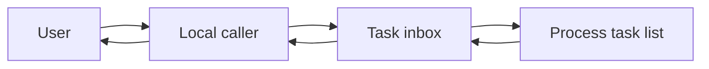
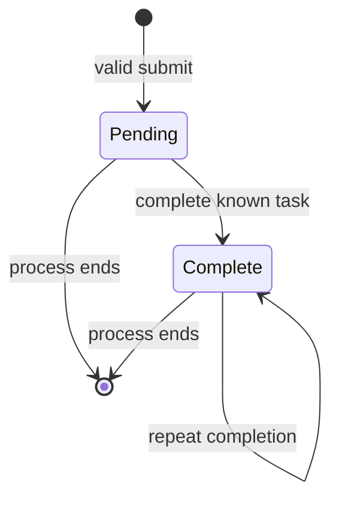
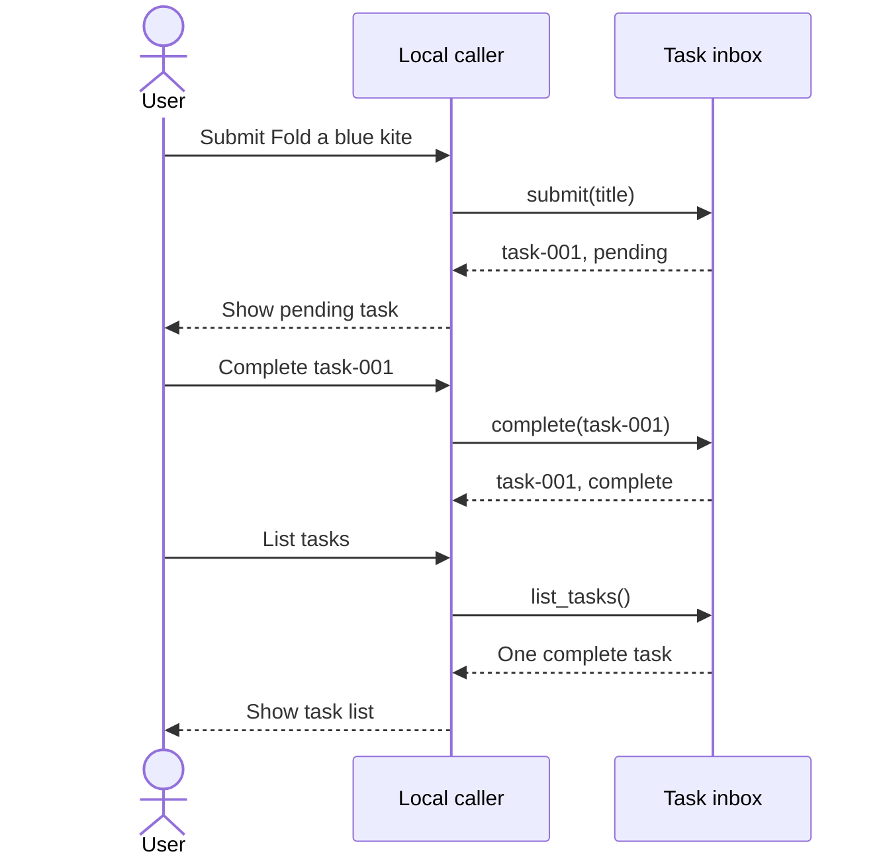

# How Acorn Tasks works

## Product position

Acorn Tasks lets a fictional user keep a small task list in one process.
This document is a synthetic reference, with no real customer or deployed service.

## Current verified status

Evidence classes describe different kinds of proof. A class does not automatically prove the next class.

| Current behavior | Evidence level | Source and scope | Missing proof |
| --- | --- | --- | --- |
| Submit, complete, and list paths exist | code verified | [TaskInbox](../acorn-tasks/src/acorn_tasks.py), `synthetic-v1`, local source inspection | No deployed service |
| State, duplicate actions, errors, and restart pass local checks | test verified | [Unit tests](../acorn-tasks/tests/test_acorn_tasks.py), `synthetic-v1`, Python 3.9.6 on macOS arm64, 9 tests passed on 2026-10-14 | No deployed scenario or acceptance proof |
| Recorded submit, complete, and list effects | runtime verified: simulated only | [Sample run](../acorn-tasks/runtime/sample-run.json), `synthetic-v1`, fictional-local-demo, 2026-10-12 | This fictional record is not evidence of actual execution |
| Product-owner acceptance | user accepted: absent | No acceptance record exists | Explicit acceptance with a scenario, version, and date remains absent |

The runtime label demonstrates classification, with its synthetic limit beside the claim.
It does not assert real integration success. User acceptance remains unverified.

## Overall behavior

The caller chooses an action. The inbox updates or reads the task list.
The service returns a copy of each task, so caller edits cannot change stored state.

## Core workflow

Submit removes outer spaces from the title. An empty title produces an error before the service allocates an identifier.
A valid submission creates a pending task. Complete changes a known task to complete.
List returns all tasks in submission order.

Repeated completion keeps one complete task. Repeated submission creates another task.
An unknown identifier produces an error without a state change.
The product has no agent workflow or tool calls. No agent loop exists.
Cancellation, retry schedules, and permission prompts have no code path.

## Representative request

The fictional user submits “Fold a blue kite”. The caller receives `task-001` with status `pending`.
The user completes that task. A list request then shows one complete task.
The sample JSON describes this sequence, but it does not prove a real run.

## Concepts

A task identifier names one task. It acts like a ticket number at a counter.
The number belongs to this inbox only. It does not identify a person or an external service.

Process memory holds tasks while the inbox exists. It acts like a temporary sheet on a desk.
A new inbox does not recover the sheet from the previous inbox.

## Module responsibilities

| Module | Product responsibility | Boundary | Source |
| --- | --- | --- | --- |
| Product requirements | Define the three actions and their limits | Product intent, not execution proof | [Requirements](../acorn-tasks/docs/product.md) |
| TaskInbox | Validate input and maintain current task state | One process, no network or disk | [Service](../acorn-tasks/src/acorn_tasks.py) |
| Unit tests | Check observable state and errors | Local synthetic inputs | [Tests](../acorn-tasks/tests/test_acorn_tasks.py) |
| Sample run | Demonstrate separate runtime evidence | Fictional effects, no actual run | [Runtime fixture](../acorn-tasks/runtime/sample-run.json) |

## Current decisions

The inbox has no disk storage. This keeps the example small but prevents recovery after restart.
The service permits duplicate titles. The caller must keep task identifiers separate.
The service returns copies to protect its state from caller edits.

## Diagnosis

| What the user sees | Likely boundary | Evidence to inspect | Safest change or check | Proof required |
| --- | --- | --- | --- | --- |
| Tasks disappear after restart | Process memory | Restart unit test and TaskInbox constructor | Define a storage requirement before a code change | A restart check with saved tasks |
| Two tasks have the same title | Submission identity | Duplicate submission test | Select the intended identifier | A list result with two distinct identifiers |
| Completion produces an error | Identifier lookup | Unknown identifier test | Check the identifier against the current list | The original task stays pending |
| No task appears after an empty submission | Input validation | Empty title test | Supply a nonempty title | One new pending task |

## Current limits and evidence gaps

Tasks disappear when the process ends. No disk persistence or deployed service exists.
The service has no cancellation, permission checks, or external delivery.
The sample runtime record is synthetic. No real runtime evidence or user acceptance record exists.

The local command was `python3 -m unittest discover -s demo/acorn-tasks/tests -v` from the package root.
It returned exit 0 with 9 tests in Python 3.9.6 on macOS arm64 on 2026-10-14.
The task report records the exact Git commit for that implementation.
An actual review must record its own command, environment, analyzed commit, and result.
The [demo README](../acorn-tasks/README.md) supplies a command for a new local execution.
Only an actual result from that command can prove that local execution.

## Sources and review record

Source authority starts with the [product requirements](../acorn-tasks/docs/product.md).
The source links above separate intent, code, local tests, and fictional effects.
Analyzed revision: `synthetic-v1`. This label identifies the fixture, not a Git commit or deployment.
Local changes: this reference describes only the `synthetic-v1` fixture.
Mermaid source syntax received a manual check. No diagram render result is recorded.

Last-reviewed date: 2026-10-14
