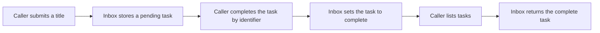

# How Acorn Tasks works

Review date: 2026-10-14. Analyzed fixture revision: `synthetic-v1`.

Acorn Tasks is a fictional task inbox with three actions: submit, complete, and list.
A caller supplies a task title or identifier to a small Python component.
The component returns task data to that caller.
It has no user interface or external delivery channel.
See the [fixture overview](../../../../demo/acorn-tasks/README.md) and [product requirements](../../../../demo/acorn-tasks/docs/product.md).

## What a task contains

Each task contains an identifier, a title, and a status.
The status starts as `pending` and can change to `complete`.
The identifier starts at `task-001` in each new inbox.

The inbox is like a paper list that exists only for one session.
Python memory holds the list. No file or database saves it.
A new inbox starts empty, even in the same process.
A new process cannot recover the old tasks.
See [TaskInbox and its storage](../../../../demo/acorn-tasks/src/acorn_tasks.py#L4).

## Submit, complete, and list

| Action | What the code does | Visible result |
| --- | --- | --- |
| Submit | Removes spaces at both ends of the title, creates an identifier, and stores a pending task. | Returns the task's identifier, title, and `pending` status. |
| Complete | Finds the task by identifier and sets its status to `complete`. | Returns that task with `complete` status. |
| List | Copies each stored task in submission order. | Returns all tasks, including complete tasks. An empty inbox returns an empty list. |

The code for these actions is [submit](../../../../demo/acorn-tasks/src/acorn_tasks.py#L8), [complete](../../../../demo/acorn-tasks/src/acorn_tasks.py#L16), and [list_tasks](../../../../demo/acorn-tasks/src/acorn_tasks.py#L21).

List also works before completion. It then returns the task with `pending` status.
Complete does not perform the activity in the title.
For example, it changes the status of “Fold a blue kite.” It does not fold a kite.

## Errors and repeated actions

- A blank title produces `ValueError` with “A task title is required.” It creates no task and consumes no identifier.
- An unknown identifier produces `KeyError`. It does not change another task.
- A repeated submission creates a separate task, even when the title is identical.
- A repeated completion keeps the same task complete. It creates no extra task.
- Returned task data is a copy. A caller's changes to that data do not change the inbox.

These behaviors follow the [code](../../../../demo/acorn-tasks/src/acorn_tasks.py) and the [local tests](../../../../demo/acorn-tasks/tests/test_acorn_tasks.py).

## Agent workflow and product boundaries

The code contains no agent workflow. The caller directly selects each action.
There is no model, planning loop, tool selection, or automatic follow-up.
The fixture has no long-term memory, cancellation, authentication, permission prompt, network connection, or retry scheduler.
See the [product boundaries](../../../../demo/acorn-tasks/docs/product.md) and [complete implementation](../../../../demo/acorn-tasks/src/acorn_tasks.py).

## Evidence and completion

| Evidence type | What this review established | Limit |
| --- | --- | --- |
| Code | All three actions exist. Their behavior matches the fixture requirements. | This is a small component, not a production service. |
| Local tests | This review executed all nine tests successfully on 2026-10-14. | Tests cover the fixture's cases. They do not prove real-user acceptance. |
| Actual local execution | This review submitted a title with outer spaces, completed its task, and listed the complete task. A new inbox returned an empty list. | This execution proves those local inputs and outputs only. |
| Fictional sample | The JSON describes submit, complete, and list with synthetic values. | It is not evidence of an actual execution. |
| User acceptance | The fixture contains no acceptance record. The sample's `acceptance` field is `null`. | No product owner or real user accepted this fixture in the available evidence. |

The local test command was `python3 -m unittest discover -s demo/acorn-tasks/tests -v` from the package root.
The result was nine tests with `OK` and exit code 0.
The [test source](../../../../demo/acorn-tasks/tests/test_acorn_tasks.py) includes a replay of the fictional sample.
That replay proves agreement between sample outputs and local code. It does not make the sample an actual run.

The separate local execution returned `task-001`, title `Fold a blue kite`, first `pending`, then `complete`.
List returned that one complete task. A new `TaskInbox` returned `[]`.
The [sample run](../../../../demo/acorn-tasks/runtime/sample-run.json) remains explicitly synthetic and uses a fictional environment.

The three fixture actions are implemented and passed local verification.
Real-channel operation and user acceptance remain unverified.
No user action is necessary to understand this fixture.
Any future claim of acceptance requires an actual review and a separate acceptance record.

Last updated: 2026-10-14.
