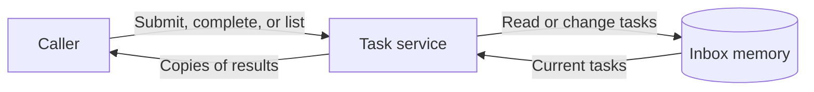
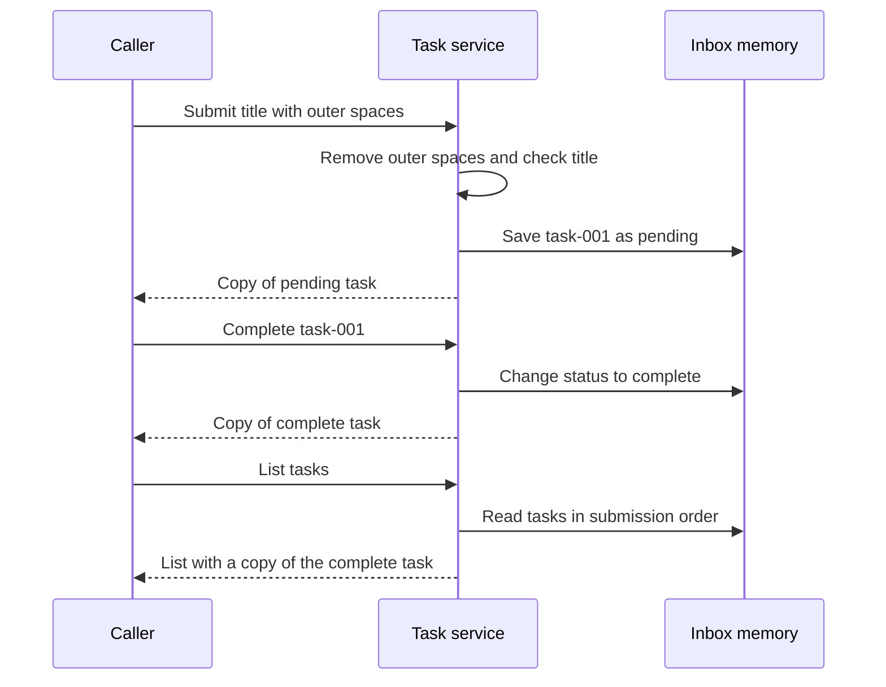

# How Acorn Tasks works

## Product position

Acorn Tasks gives a fictional user a small task list inside one process for a public documentation fixture.

## Current verified status

The analyzed fixture revision is `synthetic-v1`. All task values are synthetic. The service provides submit, complete, and list actions.

| Current behavior | Evidence level | Source | Scope and missing proof |
| --- | --- | --- | --- |
| Submit removes outer spaces and returns a pending task | Code verified, test verified, runtime verified | [Service](../../../../demo/acorn-tasks/src/acorn_tasks.py), [tests](../../../../demo/acorn-tasks/tests/test_acorn_tasks.py) | A new local execution confirmed one title. No production evidence exists. |
| Complete changes a known task to complete | Code verified, test verified, runtime verified | [Service](../../../../demo/acorn-tasks/src/acorn_tasks.py), [tests](../../../../demo/acorn-tasks/tests/test_acorn_tasks.py) | Repeated completion passed a local test. No external delivery exists. |
| List returns tasks in submission order, including complete tasks | Code verified, test verified, runtime verified | [Service](../../../../demo/acorn-tasks/src/acorn_tasks.py), [tests](../../../../demo/acorn-tasks/tests/test_acorn_tasks.py) | Local tests check task order. The new execution returned one complete task. |
| A new inbox starts empty | Code verified, test verified | [Constructor and restart test](../../../../demo/acorn-tasks/tests/test_acorn_tasks.py) | The test creates another inbox. It does not restart an operating process. |
| User acceptance | No evidence | [Product requirements](../../../../demo/acorn-tasks/docs/product.md), [fictional record](../../../../demo/acorn-tasks/runtime/sample-run.json) | No user acceptance record exists. |

Nine local tests passed on 2026-10-14 with Python 3.9.6. These results prove only their local scenarios.

## Overall behavior

A caller supplies a title or task identifier. The task service keeps records in its own memory and returns copies to the caller.
The code contains no user interface, network connection, disk store, or deployment declaration.

This diagram describes code boundaries. The memory belongs to one inbox instance.

## Core service workflow

No agent workflow exists. The caller selects each action. There is no model, plan, tool loop, long-term memory, or internal agent cooperation.

- **Submit:** The service removes spaces at both ends. An empty result raises `ValueError` and creates no task. A valid title gets the next local identifier and status `pending`.
- **Complete:** The service finds the identifier and sets its status to `complete`. An unknown identifier raises `KeyError` before any state change. Repeated completion returns the same complete task.
- **List:** The service returns copies of all records in submission order. Complete tasks remain in the list.

Each submit creates a separate task, even when the title matches another task. The service has no duplicate-submission check or retry scheduler.
Returned copies prevent changes to stored records through a result.

Restart loses tasks because no disk store or restore path exists. A new inbox also starts empty within the same process.
Cancellation, late replies, authentication, and permission prompts do not apply to this service. The code contains none of those paths.

## Representative request

The caller submits `  Fold a blue kite  `, completes `task-001`, and lists tasks.
The service returns `Fold a blue kite` with status `pending`, then returns status `complete`.
The final list contains that complete task. A new local execution confirmed these three results.

This sequence covers a successful local request. It shows no external message or user interface.

## Concepts

**Process memory** acts like a temporary notepad. The service keeps tasks there while its inbox exists. It does not preserve them after restart.

**Local identifier** acts like a numbered ticket. The first task gets `task-001`. A new inbox starts the sequence again, so identifiers are not global.

**Returned copy** acts like a photocopy of a record. A caller can change the copy without changing the record in the inbox.

## Module responsibilities

| Module | Product responsibility | Boundary |
| --- | --- | --- |
| [Task service](../../../../demo/acorn-tasks/src/acorn_tasks.py) | Validate titles, store tasks, complete tasks, and return lists | One inbox in process memory |
| [Product requirements](../../../../demo/acorn-tasks/docs/product.md) | Define expected actions and exclusions at `synthetic-v1` | Intent, not execution proof |
| [Local tests](../../../../demo/acorn-tasks/tests/test_acorn_tasks.py) | Check normal actions, errors, duplicates, copies, and empty new inboxes | Synthetic local scenarios |
| [Sample run](../../../../demo/acorn-tasks/runtime/sample-run.json) | Supply fictional input and output examples | Fictional evidence only |
| [README](../../../../demo/acorn-tasks/README.md) | Explain fixture purpose and local commands | Documentation, not production operation |

## Current decisions

The explicit request defines this review. The product requirements define intent, and the executable service establishes implementation facts.
The inspected service agrees with the stated requirements. No material source conflict exists.

The product deliberately uses memory without durable storage. It permits duplicate titles and retains complete tasks.
The caller controls execution. The service has no automatic work or external effects.

## Diagnosis

| What the user sees | Likely boundary | Evidence to inspect | Safest change | Proof |
| --- | --- | --- | --- | --- |
| Tasks disappear after restart | Confirmed memory-only storage | [Constructor](../../../../demo/acorn-tasks/src/acorn_tasks.py) and [new-inbox test](../../../../demo/acorn-tasks/tests/test_acorn_tasks.py) | Require a product decision before adding durable storage | Create a task, restart a process, and inspect the task list |
| The same title appears twice | Confirmed separate submit behavior | [Submit and duplicate test](../../../../demo/acorn-tasks/tests/test_acorn_tasks.py) | Define duplicate rules before a change to submit | Repeat one submit and observe the agreed task count |
| A blank title fails | Confirmed title check | [Submit](../../../../demo/acorn-tasks/src/acorn_tasks.py) | Supply a nonempty title | Observe a pending task with its trimmed title |
| Complete fails for an unknown identifier | Confirmed identifier lookup | [Unknown-task test](../../../../demo/acorn-tasks/tests/test_acorn_tasks.py) | Use an identifier from the current inbox list | Observe the correct task become complete |

Changes in this table are recommendations. This review changes no service behavior.

## Limits and evidence gaps

The [sample run](../../../../demo/acorn-tasks/runtime/sample-run.json) declares `synthetic: true` and `acceptance: null`.
Its fictional date and environment do not prove an actual execution. The replay test confirms agreement with sample values only.

The new local execution proves one submit, complete, and list sequence. It does not prove production operation or user acceptance.
No actual process-restart check occurred. The inspected code and new-inbox test support the absence of persistence.
The service accepts titles that support `.strip()`. Non-string inputs lack explicit validation and test evidence.

No delivery channel exists. Real-channel acceptance therefore does not apply to this fixture.

## Sources and review record

Analysis used an isolated copy of the canonical [fixture](../../../../demo/acorn-tasks/README.md).
Instruction setup created `AGENTS.md` in that temporary project. `CLAUDE.md` was absent. The original fixture remained unchanged.

- Analyzed fixture revision: `synthetic-v1`.
- Repository commit at analysis: `fffc2fd515f82e3288c4c0d5da234ca896dc36a2`.
- Environment: local Python 3.9.6, isolated synthetic fixture.
- Test command from the temporary fixture root: `python3 -m unittest discover -s tests -v`.
- Test result: nine tests passed, exit code 0.
- Runtime command from the same root: `python3 -c 'import json, sys; sys.path.insert(0, "src"); from acorn_tasks import TaskInbox; inbox = TaskInbox(); print(json.dumps(inbox.submit("  Fold a blue kite  "), sort_keys=True)); print(json.dumps(inbox.complete("task-001"), sort_keys=True)); print(json.dumps(inbox.list_tasks(), sort_keys=True))'`.
- Runtime result: pending task, complete task, and list with that complete task. Exit code 0.
- Relevant local changes: temporary instruction file and this document only. Fixture source and tests did not change.
- Diagram validation: source review only. No `mmdc` renderer was available.

Last reviewed: 2026-10-14.
