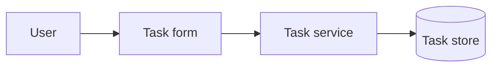
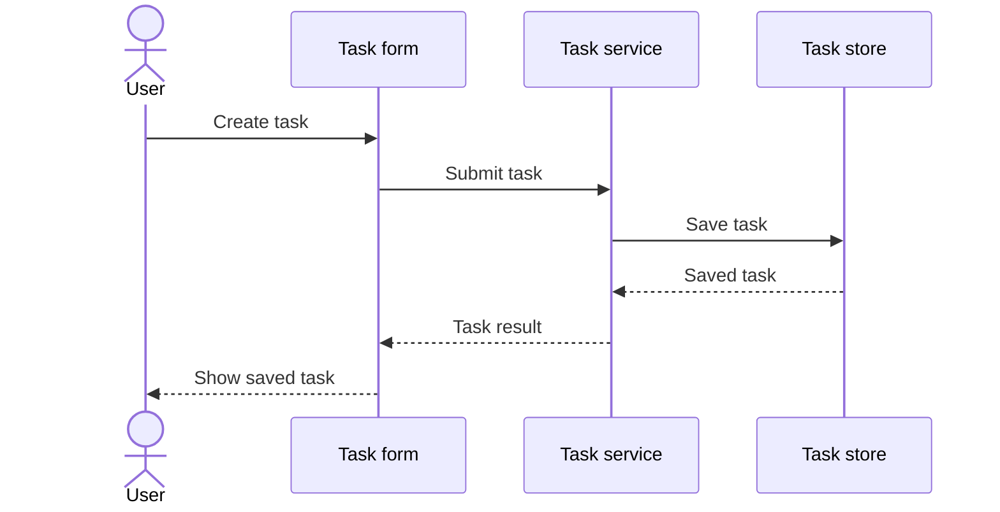
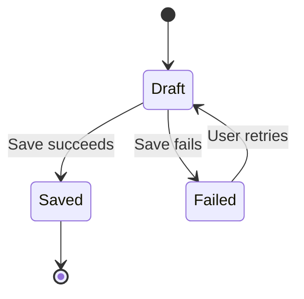
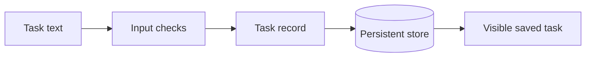

# Mermaid diagrams

Use two to four diagrams that each explain a distinct relationship.
Select diagrams from the actual product behavior and available evidence.
For a non-agent product, do not draw an agent loop.
Describe its actual service workflow instead.
Show a loop only when inspected code or recorded operation supports that loop.

## Choice rules

| Reader's question | Mermaid form | Required meaning |
| --- | --- | --- |
| Which parts cooperate? | `flowchart LR` or `flowchart TD` | Module responsibilities and system boundaries |
| What happens during one request? | `sequenceDiagram` | Ordered calls, effects, and the visible result |
| What can change or recover? | `stateDiagram-v2` | States, transition triggers, and relevant failure or cancellation paths |
| Where does information travel? | `flowchart LR` for data flow | Data, stores, consumers, and trust boundaries |

Use the sequence diagram for the representative request.
Use a flowchart for the overall system.
Add state or data flow only when it explains a separate product concern.

## Syntax patterns

These examples describe a synthetic task service.
Adapt the nodes and arrows only after inspection of the actual product.

### Module relationships

### Representative request

### State lifecycle

### Data flow

## Accuracy and validation

Give each diagram a short caption about its scope and evidence.
Separate intended paths from observed paths with explicit labels.
Mark unknown boundaries as unknown. Do not fill them with plausible components.
Do not draw a successful external delivery when only the local send path exists.

Use stable node identifiers and short product labels.
Quote flowchart labels that contain punctuation.
Use Mermaid's documented block keywords and complete fenced blocks.
Check each arrow against code or observed effects.
Check relevant failure paths without adding unsupported recovery behavior.

Render with the project's available Mermaid tool when possible.
Inspect the result for clipped labels, ambiguous paths, and unreadable detail.
If no renderer is available, report a source-only check and the render gap.
Never call a source-only review a successful render.
